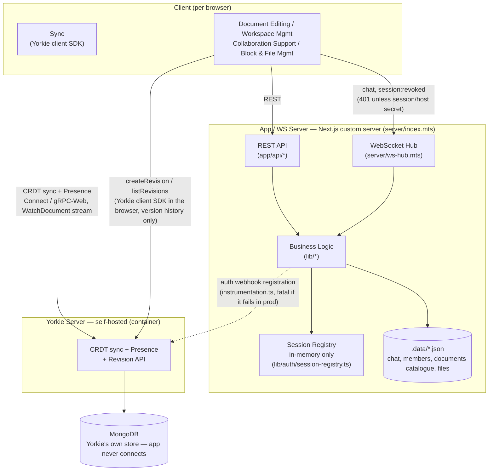

# System Architecture

Mermaid companion to the prose spec in [`docs/design/architecture.md`](docs/design/architecture.md) — read that for the interface contracts; this is the visual.

See also: the more detailed interactive version at [`docs/diagrams/runtime/`](docs/diagrams/runtime/).

## Notes

- **No internal persistence module for documents.** Yorkie owns document durability and reloads from MongoDB on its own restart — the app never opens a Mongo connection (ADR-002).
- **`.data/*.json` is the app's own store**, not Yorkie's: see [`docs/design/architecture.md`](docs/design/architecture.md) for what it holds. How writes stay atomic: [`docs/design/chat.md`](docs/design/chat.md), "Repository pattern".
- **Sessions are memory-only**; why, and the revoke path, are in [`docs/design/api.md`](docs/design/api.md).
- **Both WebSocket upgrade paths gate entry**: [`docs/design/api.md`](docs/design/api.md) §4. The race that gate closed, a device connecting its socket after `revoke()`, is #26.
- **Docker**: `app`, `yorkie` and `mongo` containers (`docker-compose.yml`); the volumes behind `DataFiles` and `Mongo` above are in [`docs/design/architecture.md`](docs/design/architecture.md) §3(d).
