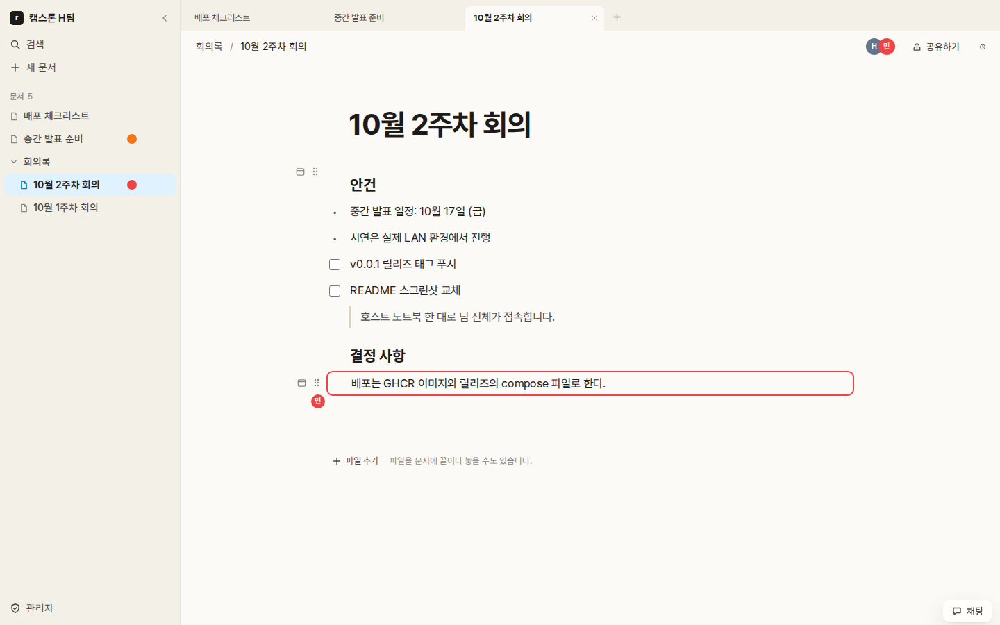
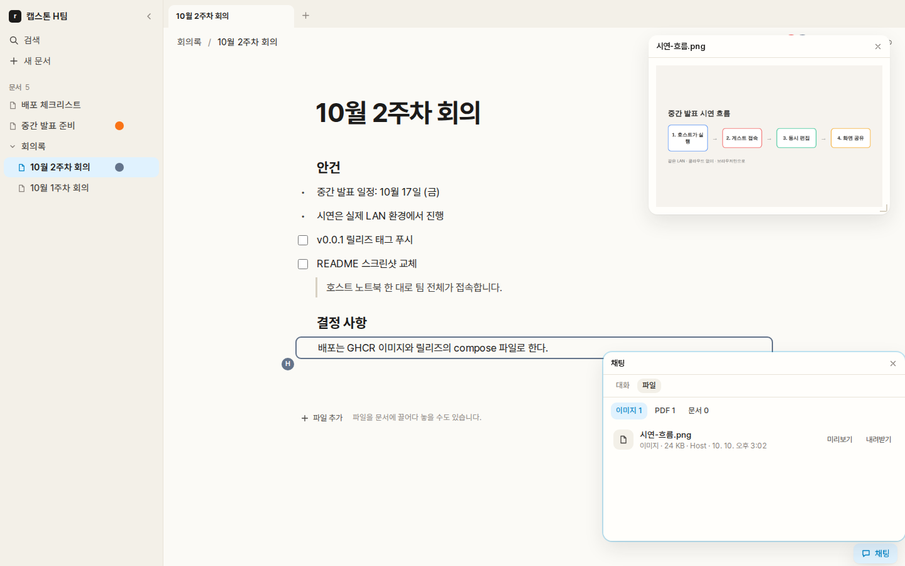
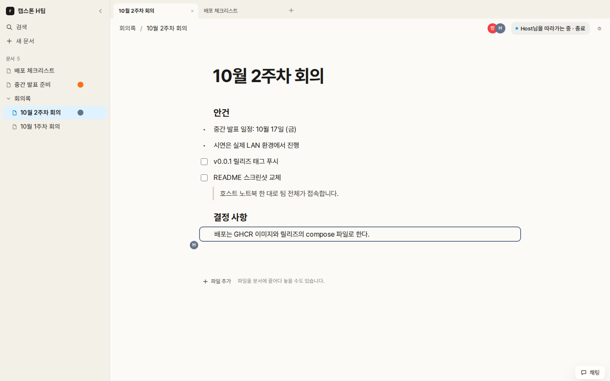
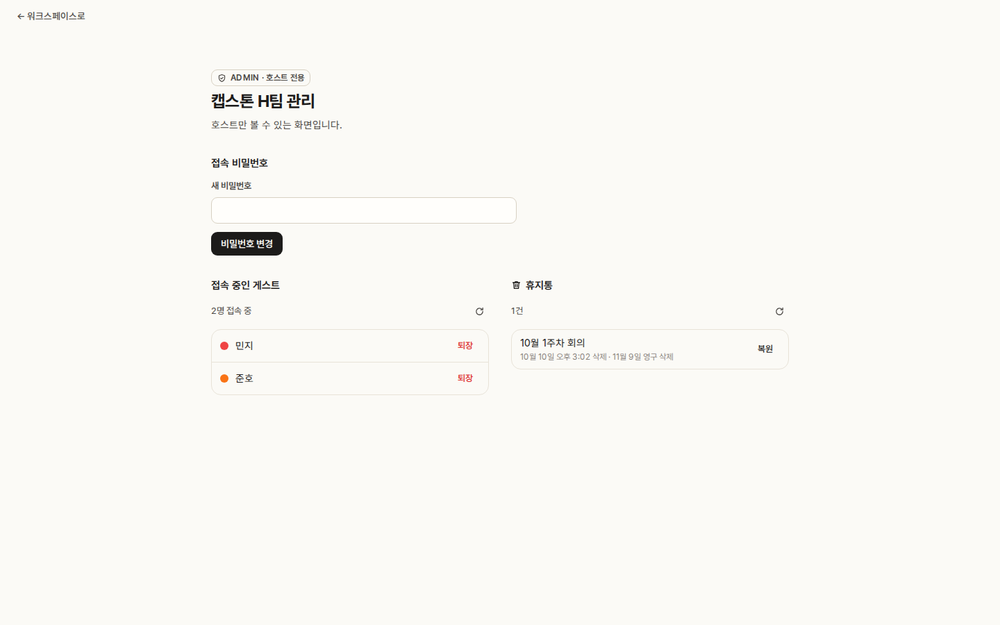

# RMF-Block

[English](README.md) · **한국어**

같은 네트워크의 팀원들이 실시간으로 함께 쓰는 블록 에디터입니다. 호스트 한 명이 Docker로 실행하면,
같은 서브넷의 팀원은 브라우저로 접속해 바로 함께 편집할 수 있습니다.

> 영문 [`README.md`](README.md)를 바탕으로 한 한국어 안내입니다. 내용이 다르면 영문을 기준으로 합니다.

| 문서 편집 | 플로팅 뷰와 채팅 |
| :---: | :---: |
|  |  |
| **화면 공유** | **관리자** |
|  |  |

## 기능

- **실시간 편집** — `/` 메뉴나 Markdown 단축키로 텍스트, 제목, 목록, 체크리스트, 인용, 코드, 표,
  이미지, PDF, 파일, 문서 링크를 넣습니다. 한글 조합 중인 글자까지 바로 반영되고, 누가 어느 블록을
  편집 중인지 색으로 보입니다.
- **문서 관리** — 트리 구조와 제목 검색, 탭, 여러 블록 한 번에 복사·잘라내기·삭제, Markdown 파일
  가져오기, 이름을 붙여 저장하고 되돌리는 버전 기록.
- **채팅과 플로팅 뷰** — 파일을 첨부할 수 있는 채팅과 파일 목록. 블록이나 파일을 플로팅 창에 띄우면
  다른 문서로 옮겨도 계속 떠 있습니다.
- **따라가기** — 내 화면 위치를 공유하면 팀원이 그대로 따라옵니다. 누가 어느 문서에 있는지 보고
  그 자리로 바로 이동할 수도 있습니다.
- **관리자** — 호스트가 워크스페이스 비밀번호를 정하고, 게스트를 내보내고, 지운 문서를 되살립니다.

## 빠른 시작

호스트 PC에 Compose 2.20 이상이 포함된 Docker가 있어야 합니다(x86-64, Apple Silicon).

1. 최신 릴리즈에서 `docker-compose.yml`과 `.env`를 [내려받습니다](#1-내려받기).
2. `.env`에 [호스트 LAN 주소](#2-호스트-lan-주소)를 넣습니다.
3. `.env`에 [Yorkie 비밀값 두 개](#3-yorkie-비밀값)를 넣습니다.
4. [3000, 8080 포트를 엽니다](#4-포트-열기).
5. [`docker compose up`으로 실행](#5-실행)하고, `Host:` 링크를 직접 연 뒤 `Guest:` 링크를 팀원에게
   알려 줍니다.

## 설치

### 1. 내려받기

```bash
mkdir rmf-block && cd rmf-block
curl -LO https://github.com/CBNU-TeamH/RMF-Block/releases/latest/download/docker-compose.yml
curl -L -o .env https://github.com/CBNU-TeamH/RMF-Block/releases/latest/download/env.sample
```

Windows PowerShell 5.1:

```powershell
mkdir rmf-block; Set-Location rmf-block
curl.exe -LO https://github.com/CBNU-TeamH/RMF-Block/releases/latest/download/docker-compose.yml
curl.exe -L -o .env https://github.com/CBNU-TeamH/RMF-Block/releases/latest/download/env.sample
```

`.env`에서는 2·3단계의 세 값만 채우고 나머지는 그대로 둡니다.

### 2. 호스트 LAN 주소

`HOST_LAN_IP`에 호스트 PC의 LAN IPv4 주소를 넣습니다(예: `HOST_LAN_IP=192.168.0.14`). 주소는
컨테이너나 WSL이 아닌 호스트 PC에서 확인합니다.

| OS | 명령 |
| :--- | :--- |
| Windows (PowerShell) | `(Get-NetIPConfiguration \| Where-Object IPv4DefaultGateway).IPv4Address.IPAddress` |
| Linux | `ip -4 route get 1.1.1.1` (`src` 뒤의 주소) |
| macOS | `ipconfig getifaddr "$(route -n get default \| awk '/interface:/{print $2}')"` |

나중에 주소가 바뀌면 `.env`를 고치고 `docker compose up -d`를 실행하세요.

### 3. Yorkie 비밀값

이 두 값이 없으면 Compose가 실행되지 않습니다. Yorkie 기본값을 그대로 쓰면 같은 LAN의 누구나 문서를
읽거나 지울 수 있기 때문입니다.

- `YORKIE_ADMIN_PASSWORD` — 영문·숫자·기호(`-` 등)를 섞은 8~30자. 나중에 바꾸면 앱이 켜지지 않으니
  처음 정한 값을 계속 쓰세요.
- `YORKIE_ADMIN_TOKEN_SECRET` — 32자 이상의 임의 문자열.

### 4. 포트 열기

게스트는 TCP **3000**(앱)과 **8080**(실시간 편집)으로 접속합니다. 페이지는 열리는데 편집 내용이 안
보인다면 대개 8080이 막혀 있는 경우입니다.

- **Windows** — 네트워크 프로필을 개인으로 바꾸고, 방화벽 알림이 뜨면 Docker Desktop을 허용하세요.
  알림이 없었다면 관리자 권한 PowerShell에서 실행합니다.
  `New-NetFirewallRule -DisplayName "RMF-Block" -Direction Inbound -Protocol TCP -LocalPort 3000,8080 -Action Allow -Profile Private`
- **macOS** — 방화벽을 켜 두었다면 Docker의 수신 연결을 허용하세요.
- **Linux** — `ufw`를 쓴다면 `sudo ufw allow 3000,8080/tcp`.

### 5. 실행

```bash
docker compose up
```

```
rmf-app  |   Host:  http://localhost:3000/api/auth/host?secret=…
rmf-app  |   Guest: http://192.168.0.14:3000
```

- **`Host:`** 링크는 호스트가 직접 엽니다. 이 링크로 들어가면 호스트가 됩니다. 컨테이너를 다시 시작할
  때까지 유효하니 다른 사람에게 노출되지 않게 하세요.
- 처음 열면 설정 화면이 나옵니다. 워크스페이스 이름과 비밀번호를 정해 팀원에게 알려 주세요. 비밀번호는
  나중에 사이드바 아래쪽 **관리자** 메뉴에서 바꿀 수 있습니다.
- 팀원에게는 **`Guest:`** 링크를 알려 줍니다.
- 컨테이너를 다시 시작하면 모두 로그아웃되지만 문서와 설정은 남습니다. `docker compose down -v`를
  실행하면 지워집니다.

## 게스트가 접속하지 못할 때

휴대폰처럼 호스트가 아닌 기기에서 `Guest:` 링크를 열어 보세요. 호스트 PC에서 열리는 것만으로는 확인이
안 됩니다. 그다음 아래를 차례로 확인합니다.

1. **Wi-Fi 격리** — 학교나 공용 Wi-Fi는 기기끼리 통신하지 못하게 막아 두는 경우가 많습니다. 휴대폰
   핫스팟으로 바꿔 시험해 보세요.
2. **포트** — 3000과 8080이 모두 열려 있어야 합니다([4단계](#4-포트-열기)).
3. **Windows 호스트** — WSL2 기반 Docker Desktop은 포트를 `127.0.0.1`에만 열어 둘 수 있습니다.
   [mirrored networking](https://learn.microsoft.com/windows/wsl/networking#mirrored-mode-networking)을
   켜거나(Windows 11 22H2 이상) `netsh interface portproxy`로 포트를 넘겨 주세요.
4. **주소 오류** — `ipconfig`, `ip -4 addr`, `ifconfig`로 Wi-Fi나 이더넷 어댑터의 IPv4 주소를 찾아
   `HOST_LAN_IP`를 다시 설정하세요. Docker·WSL·VPN 주소는 해당하지 않습니다.

## 업그레이드

백업한 뒤 새 릴리즈의 `docker-compose.yml`로 기존 파일을 덮어쓰고 `docker compose pull`,
`docker compose up -d`를 차례로 실행합니다. 백업, 되돌리기, clone에서 옮기는 방법은
[`docs/upgrading.md`](docs/upgrading.md)(영문)를 보세요.

## 문서

| 문서 | 내용 |
| :--- | :--- |
| [`docs/SRS-ko.md`](docs/SRS-ko.md) · [`docs/SRS-en.md`](docs/SRS-en.md) | 요구사항 명세(팀이 합의한 한국어 원문과 영문 번역) |
| [`docs/design/`](docs/design/) · [`docs/adr/`](docs/adr/) | 모듈 설계와 아키텍처 결정 기록 |
| [`ROADMAP.md`](ROADMAP.md) | 지금까지 만든 것과 앞으로 만들 것 |
| [`AGENTS.md`](AGENTS.md) | 작업 규칙과 문서별 역할 |

## 기여

개발 환경 설정, 검사 방법, PR을 올리는 과정은 [`CONTRIBUTING.md`](CONTRIBUTING.md)에 있습니다.

## 팀

충북대학교 캡스톤디자인 H팀. [TaeTaeJin](https://github.com/TaeTaeJin), [ujin999](https://github.com/ujin999)가
관리합니다.

## 라이선스

[MIT](LICENSE). 함께 들어 있는 Pretendard 글꼴은 SIL Open Font License 1.1을 따릅니다
([`app/fonts/PretendardVariable.LICENSE.txt`](app/fonts/PretendardVariable.LICENSE.txt)).
