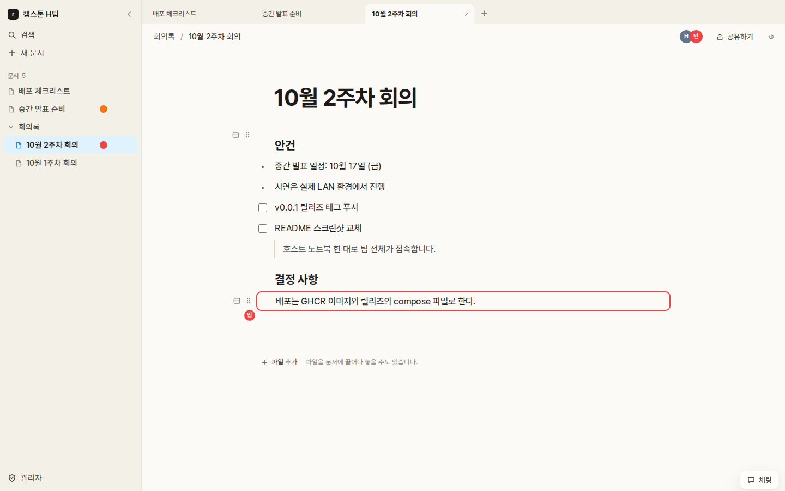
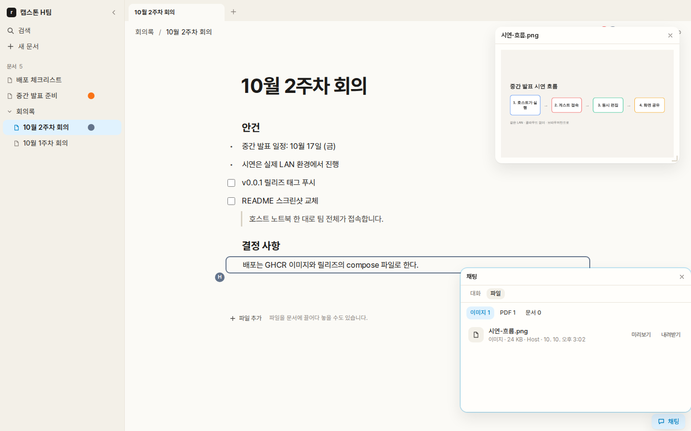
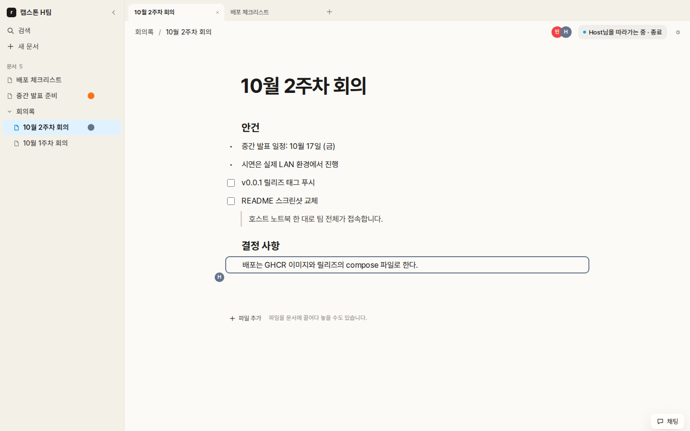
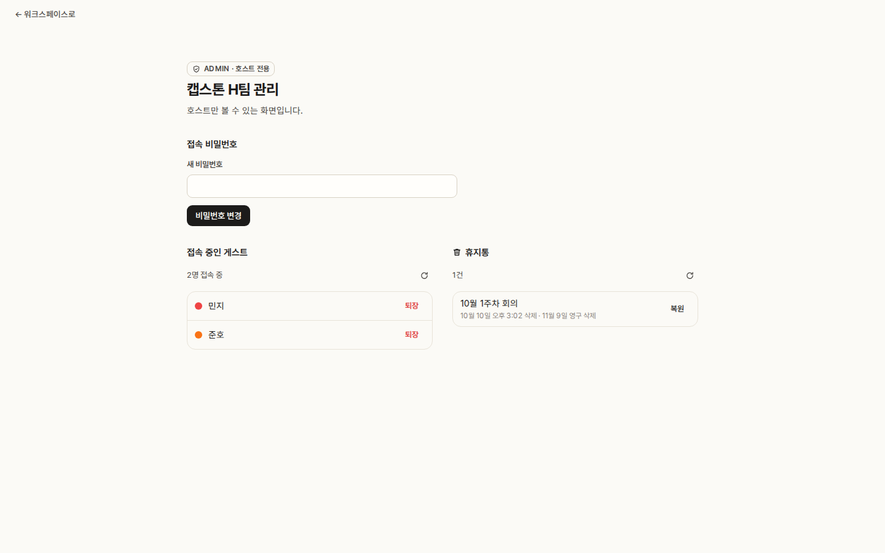

# RMF-Block

**English** · [한국어](README.ko.md)

A real-time block editor for a team on one local network. Write documents together as you type,
chat and share files, keep blocks open in floating windows, and follow a teammate's screen.

One person, the **host**, runs RMF-Block as a Docker container. Everyone else on the **same
subnet** opens a link in their browser and joins with a nickname and the workspace password.
CBNU Team H capstone project.

## Features

| Feature | What it does | Screenshot |
| :--- | :--- | :--- |
| **Document editing** | Text, headings, lists, checklists, quotes, code, tables, images, PDFs, files and links to other documents, from a `/` menu or Markdown shortcuts. Edits reach everyone as they type, Hangul composition included, and the block someone is in is outlined in their colour. Select several blocks to copy, cut or delete them together, or import a Markdown file as a new document. Documents nest in a tree you can search by title, open as tabs, and keep a version history you can name and restore. |  |
| **Floating views and chat** | Chat with attachments, and a file list grouped into images, PDFs and other files. Pin a text, image or PDF block, several selected blocks, or a file from chat, in a window that stays put while you move between documents. |  |
| **Screen sharing** | Share your position in a document; others join with one click and follow it as you scroll and move between documents, until either side ends it. The document tree shows who is in which document, and clicking someone's dot jumps to where they are. |  |
| **Admin** | Host only: open the workspace with a name and password, change the password, remove a guest, and restore deleted documents from the trash. |  |

## How it works

The host machine runs three containers: the app — a Next.js custom server for pages, REST and
WebSockets — and a self-hosted [Yorkie](https://yorkie.dev) server with MongoDB behind it. Yorkie
syncs every document as a CRDT and keeps its content and history; the app keeps its own state as
JSON under `.data/`. Documents, chat and uploaded files are stored on the host and shared over
the LAN.

[`ARCHITECTURE.md`](ARCHITECTURE.md) has the diagram; [`docs/design/architecture.md`](docs/design/architecture.md)
the contracts.

## Getting started

Install Docker with Compose 2.20 or newer, then download the two files of the latest
[release](https://github.com/CBNU-TeamH/RMF-Block/releases); the image runs on x86-64 and Apple
Silicon.

On Linux or macOS:

```bash
mkdir rmf-block && cd rmf-block
curl -LO https://github.com/CBNU-TeamH/RMF-Block/releases/latest/download/docker-compose.yml
curl -L -o .env https://github.com/CBNU-TeamH/RMF-Block/releases/latest/download/env.sample
```

On Windows PowerShell 5.1:

```powershell
mkdir rmf-block
Set-Location rmf-block
curl.exe -LO https://github.com/CBNU-TeamH/RMF-Block/releases/latest/download/docker-compose.yml
curl.exe -L -o .env https://github.com/CBNU-TeamH/RMF-Block/releases/latest/download/env.sample
```

In `.env`, set the three values below and leave the rest as supplied. The workspace name and
password are chosen in the browser after startup.

### Set the host's LAN address

Set `HOST_LAN_IP` to the host's IPv4 address on the guests' LAN, e.g. `HOST_LAN_IP=192.168.0.14`.
Find it on the host machine, not in a container or WSL:

Windows (PowerShell):

```powershell
(Get-NetIPConfiguration | Where-Object IPv4DefaultGateway).IPv4Address.IPAddress
```

Linux — the address after `src`:

```bash
ip -4 route get 1.1.1.1
```

macOS:

```bash
ipconfig getifaddr "$(route -n get default | awk '/interface:/{print $2}')"
```

If the address changes, update `.env` and run `docker compose up -d` again.

### Set the Yorkie admin secrets

Compose will not start until `.env` has two values of your own: Yorkie's defaults would let anyone
on the LAN read or delete every document.

- `YORKIE_ADMIN_PASSWORD`: 8 to 30 characters with letters, digits and a symbol such as `-`. Keep it
  once set; a different value later stops the app from starting.
- `YORKIE_ADMIN_TOKEN_SECRET`: a random string of 32 characters or more.

### Open the ports

Guests connect to **TCP 3000** (the app) and **TCP 8080** (Yorkie). A page that opens but never
shows edits usually means 8080 is blocked.

- **Windows**: set the network profile to **Private** and allow Docker Desktop when the firewall
  asks. If it did not ask, in PowerShell as administrator:
  `New-NetFirewallRule -DisplayName "RMF-Block" -Direction Inbound -Protocol TCP -LocalPort 3000,8080 -Action Allow -Profile Private`
- **macOS**: if the firewall is on, allow incoming connections for Docker.
- **Linux**: if `ufw` is active, `sudo ufw allow 3000,8080/tcp`.

### Start it

```bash
docker compose up
```

The startup output prints two links:

```
rmf-app  |   Host:  http://localhost:3000/api/auth/host?secret=…
rmf-app  |   Guest: http://192.168.0.14:3000
```

- **Open the `Host:` link yourself** — it makes you the host. Treat it as a credential; it works
  until the container restarts.
- **The first time, the setup screen opens.** Choose the workspace name and password, then tell
  guests the password. The host-only **관리자** link at the foot of the sidebar changes it later or
  removes a guest.
- **Give everyone else the `Guest:` address.**
- **Restarting the container signs everyone out.** Documents and settings survive restarts and
  upgrades; `docker compose down -v` deletes them.

### Upgrading

Back up the `app-data` and `mongo-data` volumes, and check that both Yorkie values in `.env` meet
[the rules](#set-the-yorkie-admin-secrets). Then download the new release's `docker-compose.yml`
over the old one, keep `.env`, and run:

```bash
docker compose pull && docker compose up -d
```

PowerShell 5.1 has no `&&`: run `docker compose pull`, then `docker compose up -d` if it succeeded.
An installation that ran from a clone [switches over first](CONTRIBUTING.md#switching-a-clone-to-a-release).

**Rolling back:** put the previous `docker-compose.yml` back and run the same commands. Once Yorkie
0.7.26 or later has run, an older Yorkie cannot read `mongo-data`: stop with `docker compose down`
(never `down -v`), restore the `mongo-data` backup, then put the old file back. Data written since
the backup is lost.

### If a guest cannot connect

Open the `Guest:` address on another device on the LAN, such as a phone; opening it on the host
proves nothing. If it fails, check in order:

1. **Client/AP isolation.** Campus and guest Wi-Fi often block devices from reaching each other; try
   a phone hotspot.
2. **Ports.** 3000 and 8080 must both be open ([Open the ports](#open-the-ports)).
3. **Windows hosts.** Docker Desktop on WSL2 may forward ports only to `127.0.0.1`: turn on
   [mirrored networking](https://learn.microsoft.com/windows/wsl/networking#mirrored-mode-networking)
   (Windows 11 22H2+) or forward the ports with `netsh interface portproxy`.
4. **Wrong `Guest:` address.** Set `HOST_LAN_IP` to the Wi-Fi or Ethernet adapter's IPv4 from
   `ipconfig` (Windows), `ip -4 addr` (Linux) or `ifconfig` (macOS), not a Docker, WSL or VPN one.

## Documentation

| Read | For |
| :--- | :--- |
| [`AGENTS.md`](AGENTS.md) | The working rules — workflow, coding principles, which doc answers what |
| [`docs/SRS-ko.md`](docs/SRS-ko.md) · [`docs/SRS-en.md`](docs/SRS-en.md) | Requirements: the agreed Korean text and its English translation |
| [`docs/design/`](docs/design/) · [`docs/adr/`](docs/adr/) | Module design and architecture decisions |
| [`ROADMAP.md`](ROADMAP.md) | What is built and what comes next |

## Contributing

See [`CONTRIBUTING.md`](CONTRIBUTING.md) for the development setup, the checks, and how a change
becomes a pull request.

## License

[MIT](LICENSE). The bundled Pretendard font is under the SIL Open Font License 1.1
([`app/fonts/PretendardVariable.LICENSE.txt`](app/fonts/PretendardVariable.LICENSE.txt)).
